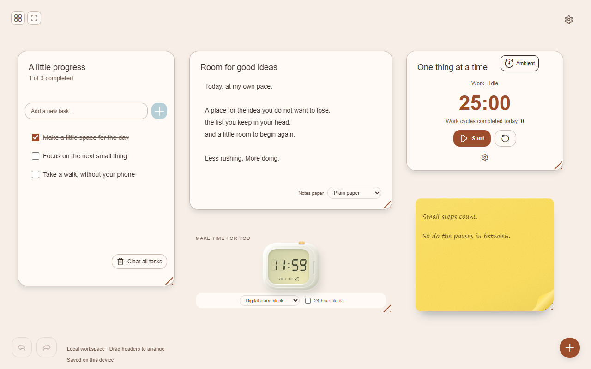
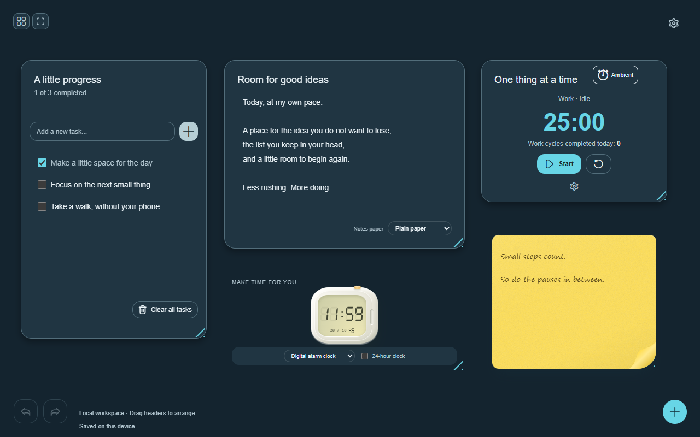
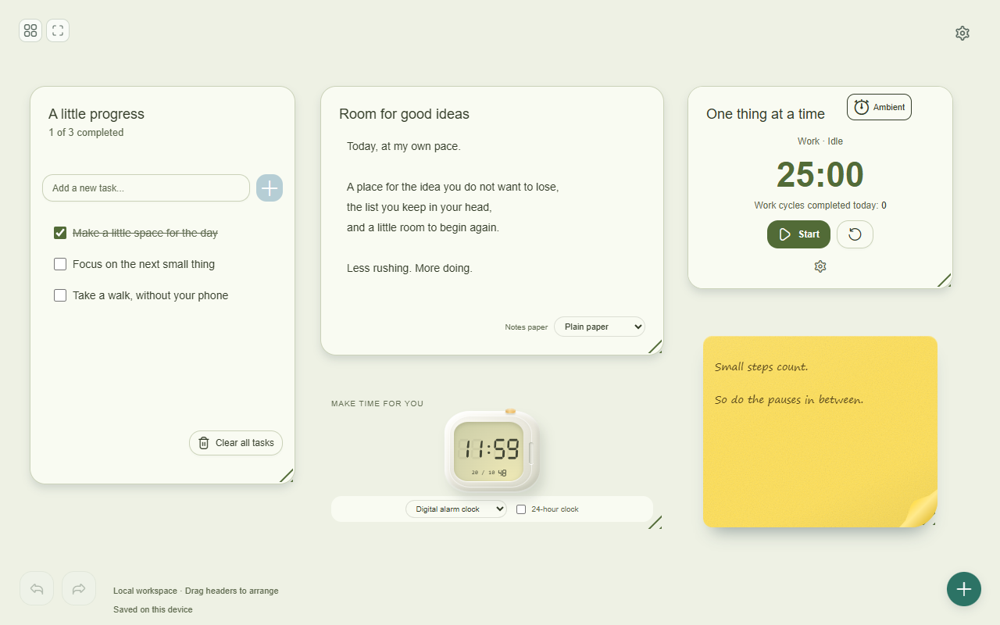

<div align="center">


# DayNest

### Make space for what matters.

A calm, personal new-tab dashboard for Microsoft Edge.<br />
For your scattered thoughts, your next small step, and a little sunshine.

**🌱 Private beta &nbsp; · &nbsp; 🔒 Local storage &nbsp; · &nbsp; 🧩 12 widgets &nbsp; · &nbsp; 🎨 12 themes**

[Product website](https://daynest-calm-new-tab.clever-tang-0272.chatgpt.site) · [Privacy](https://daynest-calm-new-tab.clever-tang-0272.chatgpt.site/privacy.html) · [Get help](mailto:aayush31500@outlook.com)



*Less tab-hopping. More headspace.*

</div>

---

## Your little corner of the browser

| Catch the thought | Make a little progress | Make it yours |
| --- | --- | --- |
| Notes, to-dos and sticky notes | Pomodoro, reminders, habits and calendar | Twelve themes, paper styles and personal media |
| A home for loose ends and ideas | Focus on the next small thing | Move, resize, customize and pin your widgets |

Clock, Date, Weather, Image and Video widgets complete the workspace. Weather includes current conditions and a seven-day forecast from Open-Meteo.

## A mood for every kind of day

<table>
<tr>
<td width="50%"></td>
<td width="50%"></td>
</tr>
<tr>
<td align="center"><b>After hours</b><br /><sub>A softer space to wind down.</sub></td>
<td align="center"><b>Made for you</b><br /><sub>Your colors. Your layout. Your rhythm.</sub></td>
</tr>
</table>

*Screenshots show the app with illustrative demo content.*

## 🔒 A small space. Your own.

- **No account, ads or built-in analytics.** Your dashboard and uploaded media stay in your browser profile.
- **Local widgets work offline.** Weather needs internet and sends your city search and resolved coordinates to Open-Meteo.
- **Portable backups.** Export and import JSON backups that include your uploaded images and videos.
- **Room to change your mind.** Undo up to 50 actions in the current tab; replacement and reset operations preserve one previous-dashboard recovery copy.

There is no automatic cloud sync. Back up important dashboards before uninstalling or moving to a new browser profile. Backups are not encrypted by DayNest.

## 🌻 Settle into your new tab

DayNest is not yet published in the Edge Add-ons store. Request beta access at **[aayush31500@outlook.com](mailto:aayush31500@outlook.com?subject=DayNest%20beta%20access)**.

For a local developer installation:

1. Build the extension using the commands below.
2. Open `edge://extensions` and enable **Developer mode**.
3. Choose **Load unpacked** and select this project's **dist** folder.
4. Accept Edge's new-tab change prompt if shown and open a fresh tab.
5. After rebuilding, select **Reload** on DayNest's extension card. Keep the same installation path to preserve its extension identity and local data.

> Export a backup from **Settings → Export JSON** before changing installations. A store installation can have a different identity from an unpacked development copy; import your backup into the new installation when needed.

<details>
<summary><strong>Developer setup · build and run</strong></summary>

## Build and run

Requires **Node 22.12+** and **pnpm 11.25.0**. Windows with Node 24 is the verified development environment.

```sh
pnpm install --frozen-lockfile
pnpm dev
```

```sh
pnpm build
pnpm test
```

The extension package is built into `dist/`. Run `pnpm preview` for a local browser preview. Preview storage is separate from installed-extension storage.

If pnpm is unavailable and dependencies are already installed:

```sh
node node_modules/typescript/bin/tsc --noEmit
node node_modules/vite/bin/vite.js build
node scripts/verify-build.mjs
node scripts/run-tests.mjs
```

</details>

## 📦 Release files

| File | Purpose |
| --- | --- |
| [Extension ZIP](release/daynest-0.1.0-candidate.zip) | Version 0.1.0 candidate; extract before loading in Edge |
| [SHA-256 checksum](release/daynest-0.1.0-candidate.zip.sha256) | Verify the candidate archive |
| [Beta kit](release/daynest-0.1.0-beta-kit.zip) | Candidate extension and tester instructions |
| [Manual testing checklist](release/manual-testing-checklist.md) | Remaining device and browser checks |
| [Store assets](release/store-assets/) | Product screenshots and listing logo |

Extract the extension ZIP to a stable folder. In `edge://extensions`, enable **Developer mode**, choose **Load unpacked**, and select the extracted folder containing `manifest.json`. This is a candidate build, not a store-certified release.

To package a fresh build on Windows, run `pnpm build`, then:

```powershell
./release/package-extension.ps1 -OutputName 'daynest-0.1.0-local.zip'
```

Choose a new filename for each package. The script preserves existing packages, checks archived files against `dist/`, and writes checksum and metadata files alongside the ZIP.

<details>
<summary><strong>Verification and everyday limits</strong></summary>

## What has been checked

The 20 October 2026 release pass includes:

- Strict TypeScript, self-contained production package validation and **93 automated tests**.
- Isolated installed Edge checks for the sunflower tab favicon, browser restart, background alarms, invalid-data preservation and recovery.
- Browser checks for multiple tabs, conflict handling, backup/import, reset recovery, local media, offline behavior and twelve theme contrast checks.
- Keyboard focus containment/return, narrow layouts, forced-colors and reduced-motion emulation.
- A 100-widget, 1.47 MB dashboard load test and a 4.86 MB image upload/reload test.
- A dependency advisory audit reporting no known vulnerabilities at the time checked.

These are scoped checks, not a complete accessibility or platform certification. **Physical sleep/resume, genuine Windows notification popups, NVDA, physical touch, external beta feedback and store certification remain open.** See the [release report](docs/public-release-2026-10-20.md) for evidence and limits.

## Everyday details

| Item | Current behavior |
| --- | --- |
| Images | PNG, JPEG or WebP; up to 5 MiB each |
| Videos | Supported MP4/WebM; up to 25 MiB and five minutes |
| Backups | Up to 50 MiB; can contain personal text and uploaded media |
| History | Up to 50 actions per tab; clears on reload/replacement |
| Recovery | One previous dashboard; reset is not a full secure erase |
| Notifications | Optional; the browser, Windows, sleep and shutdown can delay or suppress them |
| Weather | Open-Meteo public endpoint; non-commercial terms and rate limits apply |

Long-term pricing is undecided. A commercial launch requires an appropriate weather-service arrangement or a change to the weather feature. Do not put a paid service's secret API key in a distributed extension.

</details>

## 🌐 Visit DayNest

Visit the **[DayNest website](https://daynest-calm-new-tab.clever-tang-0272.chatgpt.site)** for the product overview and beta information.

- [Privacy policy](https://daynest-calm-new-tab.clever-tang-0272.chatgpt.site/privacy.html)
- [Support](https://daynest-calm-new-tab.clever-tang-0272.chatgpt.site/support.html)
- [Website source](website/daynest/dist/index.html)

## Find your way around

| Guide | What you will find |
| --- | --- |
| [Release report](docs/public-release-2026-10-20.md) | Current evidence, unresolved gates and next steps |
| [Developer guide](docs/developer-guide.md) | Detailed behavior, workflows and earlier verification |
| [Storage and recovery](docs/storage.md) | Persistence, validation, migrations and recovery |
| [Backups and history](docs/backup-history.md) | Export/import and undo contracts |
| [Weather provider](docs/weather-provider.md) | Requests, caching, attribution and provider terms |
| [Beta plan](release/beta-plan.md) | Tester tasks and feedback collection |
| [Store listing](release/store-listing.md) | Prepared copy, permissions and certification notes |
| [Website source](website/daynest/dist/index.html) | Product, privacy and support pages |

## Credits and support

The sunflower is DayNest's pixel-art brand icon, created from the supplied sunflower reference. UI icons are **[Flaticon Uicons](https://www.flaticon.com/uicons)**, with visible credit in Settings. React and React DOM use the MIT license. Weather data is provided by **[Open-Meteo](https://open-meteo.com/)** under CC BY 4.0; API service terms apply separately. See [third-party notices](public/licenses/third-party.txt) and the [Flaticon license](public/licenses/flaticon.txt).

Questions, ideas or a rough edge? **[aayush31500@outlook.com](mailto:aayush31500@outlook.com)**. Please remove private dashboard content from screenshots and do not email full backups by default.

<div align="center">

---


*Small steps count. So do the pauses in between.*

</div>
